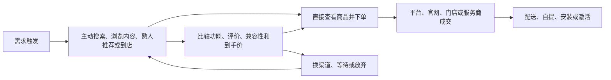

# 智能硬件消费者购买路径与渠道图谱

适用于面向消费者的智能家居、穿戴、音频、办公、移动配件及家电类硬件。以下按购买机制覆盖主流路径，并给出国内外市场的代表平台和门店。平台功能取决于国家或地区、账号、SKU、卖家和履约方式。

一笔订单至少记录四件事。**用户在哪发现商品、在哪比较、在哪下单、谁交付。** 用户在 Instagram 看见演示、去 YouTube 查测评、在 Amazon 搜型号付款、由第三方卖家发货，是一条完整的购买路径。

## 需求从哪里来

| 需求触发 | 用户会找什么 | 容易决定成交的条件 |
| --- | --- | --- |
| 故障、丢失或临时急用 | 同型号替换、附近现货、当日送达，如临时替换充电器或路由器 | 最晚到手时间、同款兼容、本地库存 |
| 已知问题待解决 | 搜「会议太吵怎么录音」「家里 Wi-Fi 覆盖差」，先找办法再看设备 | 能否解决问题、预算、安装难度、替代做法 |
| 升级或换新 | 搜上一代与新款对比、折抵、维修或二手价，如更换运动手表 | 功能增量、迁移成本、旧机估价、售后 |
| 补全已有设备生态 | 在品牌 App、官网或社区查同品牌、同协议配件 | 手机和系统版本、连接标准、网关、地区或账号限制 |
| 项目或环境变化 | 搬家、装修、开店、旅行或开始运动时找整套产品 | 空间条件、交付日期、安装服务、配套和总预算 |
| 看到演示后想试 | 短视频、直播或亲友使用呈现某个具体场景，如自动清洁或实时翻译 | 演示可信度、用途是否适合自己、退货试用条件 |
| 优惠时机与送礼 | 大促、直播优惠、节日前补货、礼品导购或礼品卡 | 券后总价、收货日期、礼品体验和收礼人兼容性 |
| 新技术与尝鲜 | 发布会、测评、社区讨论、预售或众筹 | 创新功能、可信交付时间、质保和退款条款 |

需求还可能被推迟、用旧设备解决或转向竞品。安装型硬件中，使用者、付款者和负责安装的人可能分别是家庭成员、房东和服务商。

## 从发现到购买的常见路径

| 路径 | 消费者的典型动作 | 可能的成交入口 |
| --- | --- | --- |
| 货架电商主动搜 | 搜问题、品类、品牌或型号，看搜索结果、榜单、评价及卖家 | Amazon 各国站、淘宝／天猫、京东、Walmart.com、各地综合平台 |
| 货架推荐和促销 | 逛首页、同类推荐、活动会场、优惠券或价格提醒，看替代商品 | 原平台商品页和结账，也可能跨平台比价后成交 |
| 搜索引擎、商品聚合和比价 | Google、Bing 或百度搜需求，查看自然结果、付费结果、规格和价格 | 品牌站、当地零售商、电商平台，或导航到附近门店。 [Google 商品展示](https://support.google.com/merchants/answer/13889434?hl=en) · [Google 本地商品](https://support.google.com/merchants/answer/15310605?hl=en) |
| 短视频或直播站内成交 | 看 TikTok、抖音、快手直播或演示，点商品卡，核对优惠及配送 | 符合条件的 TikTok Shop、抖音电商或快手小店。也有用户直接从商城搜索。 [TikTok Shop](https://ads.tiktok.com/resources/help/article/tiktok-shopping-and-showcase) · [抖音电商](https://school.jinritemai.com/doudian/web/course-series/cHUrTfRse7fr/cHUrTfRse7frlHV3KkY5ftox) · [快手财报](https://ir.kuaishou.com/zh-hans/node/11286/pdf) |
| 社媒种草后站外买 | 看 Instagram、Facebook、TikTok 或 Pinterest 内容，点主页或商品标签，或者稍后自行搜索型号 | 官网、Amazon 或当地零售商。Instagram 的 Shopify 接入可从商品标签跳商家站结账。 [Instagram Shopping](https://help.shopify.com/en/manual/online-sales-channels/social-commerce/facebook-instagram-by-meta/instagram) · [Pinterest Shopping](https://business.pinterest.com/shopping/) |
| 长测评、攻略和联盟导购 | 看 YouTube、B站、科技媒体、知乎、Reddit 或专业论坛，验证评测、配件兼容、长期体验 | 简介链接或商品标签导向官网、电商或达人店，部分合格店铺可在 YouTube App 内结账。 [YouTube 应用内结账](https://support.google.com/youtube/answer/16030140?hl=en) · [YouTube Shopping](https://support.google.com/youtube/answer/12257682?hl=en) · [Amazon 创作者联盟](https://affiliate-program.amazon.com/) |
| 付费广告推动 | 搜索结果看到关键词广告，刷信息流或视频时看到演示，或浏览商品后再次看到再营销广告 | 广告进入产品详情、独立站、站内商品卡、客服私信或门店预约。平台站内赞助位也可能出现在搜索和商品页。 [Amazon 赞助商品](https://advertising.amazon.com/help/GJUCNANNV3GQVXJZ) · [Walmart Connect](https://www.walmartconnect.com/solutions/sponsored-products) |
| 熟人、社区或客服推荐 | 亲友体验、社群问答、群分享、微信／WhatsApp 私聊咨询，确认规格与售后 | 微信小店、品牌小程序、官网付款链接、平台订单或到店购买。 [腾讯微信](https://www.tencent.com/products/weixin-wechat/) · [WhatsApp 商品目录](https://developers.facebook.com/docs/whatsapp/guides/commerce-guides/share-products-with-customers/) |
| 品牌直营和生态复购 | 经品牌 App、官网、邮件、发布会、门店或已有设备入口了解升级和配件 | 品牌官网、App、小程序、品牌直营店或授权卖家。旧机折抵、分期、延保可影响决策。 [Apple Trade In](https://www.apple.com/shop/trade-in) · [华为商城](https://www.vmall.com/help/faq-16712.html) |
| 线下试用后买 | 逛商场、电子连锁或专柜，动手体验、问店员、扫码核对价格 | 门店收银、同一零售商网站或另一平台。试用记录是后续购买的辅助触点 |
| 线上研究后到店 | 看测评、价格和附近现货，到店试用、预约体验或直接购买 | 到店付款记门店成交，线上付款后到店取货记线上成交与门店履约。 [Walmart 自提和配送](https://www.walmart.com/help/article/pickup-and-delivery/d0d02a5f54e54592930f110aaf6a2f50) · [Best Buy 自提](https://www.bestbuy.com/site/help-topics/store-pickup/pcmcat204400050014.c?id=pcmcat204400050014%2F) |
| 本地即时零售 | 急用时搜索附近库存，比较送达时间及门店 | 美团闪购、京东秒送等线上下单，由本地门店拣货和配送。具体库存和时效随 SKU 及地点变动。 [美团数码家电](https://www.meituan.com/news/NN250510085005884) · [京东秒送](https://ir.jd.com/static-files/26afb5c0-41a8-4d14-b186-2616b9fda67e) |
| 套餐、上门安装和服务商 | 向运营商、品牌安装商或装修方咨询，预约、勘测或报价 | 营业厅、经销商合同或服务商收款。订金、全款、验收、激活和服务续费分别记录。 [Verizon 换购](https://www.verizon.com/support/trade-in-program-faqs/) · [Aqara 安装预约](https://saas.aqara.cn/booking/apple/banner.html) |
| 众筹、预购和候补名单 | 从创作者、社区、发布会或品牌页发现新品，报名、支持或预订 | Kickstarter、Indiegogo 或品牌预购。报名、支持承诺、付款及交付按各自条件记录。 [Kickstarter 支持流程](https://updates.kickstarter.com/how-to-back-a-crowdfunding-project-on-kickstarter/) · [Indiegogo 预购](https://help.indiegogo.com/article/690-preorder-overview) |
| 二手、翻新和折抵 | 因预算或老型号需求去二手、官翻或以旧换新渠道，核对成色、配件、解绑、质保 | 闲鱼、eBay、Back Market、品牌官翻店、折抵后补差价。 [阿里淘宝生态](https://www.alibabagroup.com/en-US/about-alibaba-businesses-1744508703945523200) · [Apple Trade In](https://www.apple.com/shop/trade-in) |

购物助手也是发现入口。用户可以询问匹配需求的型号、参数或兼容性，再转到平台或商家完成购买。自动推荐和主动提问可以分别记录。 [Amazon 购物助手](https://www.aboutamazon.com/news/retail/alexa-for-shopping-ai-assistant) · [阿里千问淘宝购物入口](https://www.alibabagroup.com/zh-HK/document-1991231293551017984)

## 指定平台在路径中的角色

| 平台 | 发现与比较入口 | 成交和交付 |
| --- | --- | --- |
| Amazon | 站内搜索、类目榜单、推荐、赞助结果、评价、站外达人或媒体 | Amazon 当地站结账，记录 Amazon 自营或第三方卖家、平台或卖家履约。 [Amazon 各国站](https://sell.amazon.com/global-selling) · [Amazon 站内广告](https://advertising.amazon.com/help/GJUCNANNV3GQVXJZ) |
| Instagram | Reels、帖子、Stories、创作者、广告、品牌简介、私信 | 可经商品标签或链接进入商家网站。也可能看完自行到其他平台搜索，或私信咨询后买。 [Instagram Shopping](https://help.shopify.com/en/manual/online-sales-channels/social-commerce/facebook-instagram-by-meta/instagram) |
| TikTok | 推荐流、达人测评、直播、橱窗、广告、Shop Tab | 开通 Shop 且商品有相应资格时可站内成交。各市场也有经官网或电商成交的站外路径。 [TikTok Shop](https://ads.tiktok.com/resources/help/article/tiktok-shopping-and-showcase) |
| 淘宝／天猫 | 品类、品牌和型号搜索，推荐、评价、直播或外部种草 | 淘宝体系结账，区分淘宝店、天猫旗舰店及天猫国际等订单类型。 [阿里淘宝生态](https://www.alibabagroup.com/en-US/about-alibaba-businesses-1744508703945523200) |
| 京东 | 搜索、推荐、产品对比、门店体验 | 京东 App／网站区分自营和第三方销售，也可京东 MALL 等门店成交。即时零售按实际履约记。 [京东渠道和门店](https://ir.jd.com/zh-hans/node/11991) |
| Temu | 搜索、推荐、促销、海外广告或分享 | Temu 订单按实际卖家及发货地点记本地或跨境履约，比较到手总价和送达时效。 [Temu 本地卖家计划](https://www.temu.com/about_temu/temu-expands-marketplace-access-shopify-businesses.html) |
| Walmart | Walmart.com 和 App 的搜索、推荐和广告，门店陈列和体验 | Walmart.com 自营或第三方订单、线下 POS 订单、线上支付门店自提是不同路径。自提资格按实际商品和卖家记录。 [Walmart 第三方卖家](https://www.walmart.com/help/article/marketplace-sellers-on-walmart/33258c6228d94acbbcbdaf6b7b0b616b) · [Walmart 自提和配送](https://www.walmart.com/help/article/pickup-and-delivery/d0d02a5f54e54592930f110aaf6a2f50) |

## 按市场查找交易渠道

以下是适合做渠道字典的代表性入口。同一集团可能同时运营自营、第三方市场和实体门店。面向一个市场建立实验前，以具体国家、邮编、SKU、卖家及当期可购或自提状态确认。

| 市场 | 综合货架和跨境入口 | 专业零售与门店入口 |
| --- | --- | --- |
| 中国大陆 | 淘宝／天猫、京东、拼多多、抖音电商、快手小店、微信小店或品牌小程序、小红书电商、即时零售 | 京东 MALL、苏宁、品牌直营及授权店、运营商、区域数码家电店、安装服务商。 [PDD 年报](https://www.sec.gov/Archives/edgar/data/1737806/000110465926050727/pdd-20251231x20f.htm) · [小红书买手](https://school.xiaohongshu.com/rule/detail/36078) · [微信](https://www.tencent.com/products/weixin-wechat/) |
| 中国大陆的评估入口 | 小红书笔记、B站测评、知乎问答、微信社群、什么值得买和百度搜索 | 用户可以从这些入口导流，也可看完后自行打开淘宝、京东、品牌商城或前往门店。 [B站营销地图](https://www.bilibili.com/blackboard/activity-BPiQy33YHl.html) · [知乎好物](https://www.zhihu.com/grapp/activity/goods-top-hundred-ranking) |
| 香港、澳门及台湾 | 香港 HKTVmall，台湾 momo、PChome、Shopee、Coupang | 丰泽、百老汇、三创、灿坤、品牌直营或授权店。 [HKTVmall](https://www.hktv.com.hk/uploads/1725344716995-PR_20240903_C_W.pdf) · [丰泽自提](https://www.fortress.com.hk/zh-hk/pick-up-location) · [Coupang 市场](https://www.aboutcoupang.com/what-is-coupang-services-overview/) |
| 美国及加拿大 | Amazon、Walmart、eBay、Target、Costco、Temu、美国 TikTok Shop | Best Buy、Newegg、B&H、Micro Center、Canadian Tire、Home Depot、Lowe’s、运营商。 [Walmart 市场](https://corporate.walmart.com/about/international/about/marketplace) · [Best Buy Marketplace](https://www.bestbuy.com/site/marketplace/marketplace-faq/pcmcat273700050015.c?id=pcmcat273700050015) · [Home Depot 安装类商品](https://www.homedepot.com/b/Heating-Venting-Cooling-Thermostats-WiFi-Thermostats/Pick-Up-Today/In-Home-Installation-Available/Express-Delivery/N-5yc1vZc5klZ1z175a5Z1z17iycZ1z2658n) |
| 英国、法国、德国和西欧 | Amazon 各国站、eBay、Cdiscount、OTTO、Kaufland、bol、Temu、AliExpress | 英国 Argos、Currys、John Lewis，法国 Fnac／Darty、Boulanger，德国 MediaMarkt／Saturn，荷比 Coolblue，西班牙 PcComponentes、El Corte Inglés。 [Amazon 各国站](https://sell.amazon.com/global-selling) |
| 北欧、中东欧及土耳其 | Allegro、eMAG、Trendyol、Hepsiburada，按市场也有 Amazon 或其他跨境渠道 | Elkjøp／Elgiganten、POWER、Alza，各国电子连锁、运营商与安装门店。 [Allegro 市场](https://help.allegro.com/en/marketplaces) · [Trendyol 市场说明](https://developers.trendyol.com/v3.0/docs/4-frequently-asked-questions) |
| 拉丁美洲 | Mercado Libre／Mercado Livre，墨西哥和巴西的 Amazon，巴西 Shopee、Magalu，按市场有 TikTok Shop | 墨西哥 Walmart、Coppel、Liverpool，巴西 KaBuM!，智利等市场的 Falabella、Ripley。 [Mercado Libre 年报](https://www.sec.gov/Archives/edgar/data/1099590/000109959026000006/meli-20251231.htm) · [Falabella 零售业务](https://investors.grupofalabella.com/english/business-units/) |
| 东南亚 | Shopee、Lazada、TikTok Shop，印尼 Tokopedia／Blibli | 当地电子卖场、商场品牌店、移动运营商。印尼消费者的 Tokopedia 与 TikTok Shop 入口可以分开记录。 [Shopee](https://shopee.com/) · [Lazada](https://group.lazada.com/en/about/) · [Tokopedia 和 TikTok Shop](https://newsroom.tiktok.com/memahami-tokopedia-tiktok-shop-seller-center-mitos-vs-fakta?lang=id-ID) |
| 日本及韩国 | 日本 Amazon、Rakuten Ichiba、Yahoo! Shopping，韩国 Coupang、Naver Shopping、Gmarket | 日本 Yodobashi、Bic Camera、Yamada Denki，韩国 Hi-Mart、品牌体验店和运营商。 [Rakuten 产品服务](https://global.rakuten.com/corp/about/company/internet_service/) · [Coupang 市场](https://www.aboutcoupang.com/what-is-coupang-services-overview/) |
| 印度及南亚 | 印度 Amazon、Flipkart，其他市场按本地站点补录，如部分国家的 Daraz | Croma、Reliance Digital、手机专营店、城市经销商、运营商。 [Amazon 各国站](https://sell.amazon.com/global-selling) · [Croma 全渠道](https://www.croma.com/about-croma) |
| 澳大利亚及新西兰 | Amazon AU、eBay、Kogan、新西兰 Trade Me | JB Hi-Fi、Harvey Norman、Officeworks、Noel Leeming，品牌和运营商门店。 [Amazon 各国站](https://sell.amazon.com/global-selling) |
| 中东、北非和撒哈拉以南非洲 | 阿联酋、沙特、埃及的 noon 和 Amazon 当地站，Jumia 各国站，南非 Takealot | Jarir、Extra、Sharaf DG、当地家电经销商和运营商。 [noon 市场](https://help.noon.com/portal/en/kb/articles/seller-onboarding-faq) · [Jumia 覆盖](https://group.jumia.com/download/files/press/media-kit/Jumia_mediakit_2026.pdf) · [Takealot](https://www.takealot.com/) |
| 东欧及中亚其他市场 | 俄罗斯 Ozon、Wildberries，哈萨克斯坦 Kaspi.kz 等本地平台 | DNS、M.Video、Technodom、Sulpak 等电子零售和本地经销商。 |

同一类别还有价格比较、垂直社区和特定产品渠道。例如相机去摄影店、可穿戴设备去运动连锁、智能锁经建材和安装渠道、联网终端经运营商。地区比价站可作为评估入口，例如 idealo、Geizhals、Kakaku.com 和 Price.com.hk。在线交易入口可以来自品牌自营站，Shopify 等建站或支付工具作为技术基础设施记录。

## 线下、电商和安装怎样衔接

| 渠道类型 | 典型发现或试用入口 | 如何记成销售 |
| --- | --- | --- |
| 品牌直营店、展厅、店中店和快闪 | 路过、线下活动、预约试用、发布会 | 门店收款、扫品牌二维码后线上下单，或转介绍到同款的官方店 |
| 综合商超、会员仓储和百货 | 每周采购、陈列、店内活动、会员会场 | 门店 POS，或通过零售商 App 下单后自提或配送 |
| 专业电子、家电和摄影连锁 | 向店员问规格、对比试用、查库存和配送 | 专业零售商门店或网店。同名平台的第三方订单按卖家政策处理。 [Best Buy 第三方商品规则](https://www.bestbuy.com/site/marketplace/marketplace-faq/pcmcat273700050015.c?id=pcmcat273700050015) |
| 建材、智能家居服务商和区域授权分销 | 样板间、家装、经销商或电工上门推荐 | 预约、勘测、报价、订金、安装验收和尾款分别记事件。 [Aqara 安装预约](https://saas.aqara.cn/booking/apple/banner.html) |
| 运营商、宽带与设备套餐 | 宽带续约、手机升级、路由器或联网终端套餐 | 设备付款、分期、账单抵扣和套餐激活分别记。 [Verizon 换购规则](https://www.verizon.com/support/trade-in-program-faqs/) · [中国移动线上渠道](https://www.10086.cn/support/service/channel/online/sd/) |
| 垂直场景零售和活动 | 机场旅行配件、运动店穿戴设备、行业展会或线下演示 | 现场付款、扫码线上订单或留下预约。留资和报价先于购买 |
| 本地履约网络 | 在线查附近货架、到店、路边自提或请求即时配送 | 线上付后取货、线上预约后门店付、门店下单后送货、线上付后骑手送分别建路径。 [丰泽自提](https://www.fortress.com.hk/zh-hk/pick-up-location) · [Apple 中国配送与取货](https://www.apple.com.cn/shop/help/shipping_delivery) |

## 给 Counterfolk 的实验口径

用渠道作为**触点网络**。一位用户可多次回访、换平台、等促销或退出。同一个平台至少可提供不同类型的入口，例如 Amazon 的主动搜和站内广告，TikTok 的推荐视频、直播和购物搜索。线下记录到店前意图、是否看见陈列、是否体验和是否付款。比较 A/B 时，把这些阶段与最终付款的分母对齐。

| 应记录的数据 | 示例 |
| --- | --- |
| 需求和约束 | 故障急用、潜在兴趣、预算、最晚到货、已有生态、安装资格 |
| 触点序列 | 时间、平台、入口、自然或广告、商品及素材版本、事件、可观测性 |
| 确认可买的条件 | 站点和邮编、SKU、卖家、库存、到手价、券、配送承诺、退换和保修 |
| 交易和履约 | 成交平台、真实卖家、配送或自提、付款、折抵、取消、退款、安装和激活 |
| 连续路径的证据 | 可观测跳转、购后问卷自报、汇总估计或未知 |

最小可观测的线上事件可以用商品列表、商品详情、加购、发起结账、付款和退款。实体店补到店、试用、报价和门店付款。像「有兴趣」「考虑购买」这类内部状态，可用停留、收藏、加购或询价作代理指标，并保留各自定义。 [GA4 电商事件](https://developers.google.com/analytics/devguides/collection/ga4/ecommerce)

销售量优先用去重的已付款订单或购买者。预订、订金、支付成功、收货和设备激活各有分母，净成交另计取消和退款。站内搜索测试可以观察详情到付款转化。渠道投放实验如果影响曝光机会，则以预先定义的合格分配对象为主分母，再比较各阶段。跨平台手动搜索时保留「未知首次来源」，带标签的链接点击仅覆盖可跟踪的一部分触点。归因金额和随机试点测得的增量使用各自口径。 [Amazon Attribution](https://advertising.amazon.com/help/GBT6KJJEM7NDJG6U) · [在线对照实验](https://www.exp-platform.com/Documents/controlledExperimentDMKD.pdf)

以一台智能空气监测器为例，可以用三个不同路径检验同一商品。

| 路径 | 只改变的变量 | 需要核对的结果 |
| --- | --- | --- |
| 居民主动搜索 → Amazon 或京东 → 详情页 → 付款 | 详情主图或到手价 | 搜索曝光、详情访问、下单和退款 |
| 居民刷到 TikTok 或抖音短视频 → 商品卡 → 站内付款 | 前几秒的演示内容 | 有效观看、点击商品、支付。用同一商品和同一价格 |
| 居民看完 Instagram 或小红书 → 搜型号 → 门店试用或官网付款 | 内容强调健康使用场景或设备兼容性 | 品牌搜索、门店或官网订单、来源可观测比例。独立试点核对内容带来的增量 |
